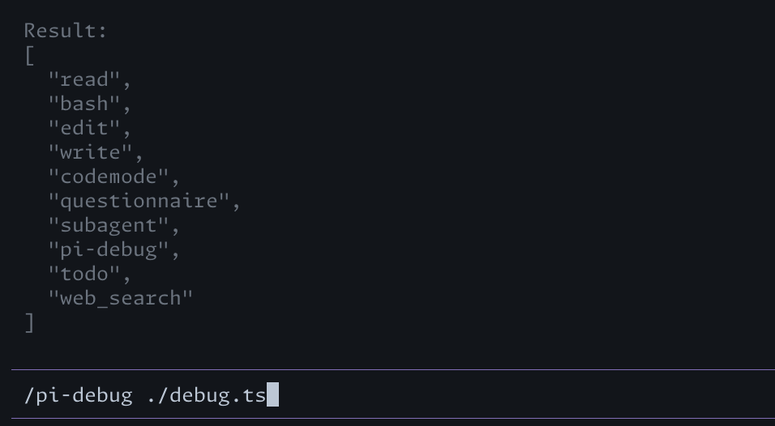

# pi-debug

This is a [Pi](https://pi.dev) extension for Pi extension developers. It enables running Typescript within the Node.js context of the Pi coding agent. It provides 2 methods.

1. An AI facing tool "pi-debug"
2. A user facing slash command "/pi-debug"

<p align="center">
    
</p>

## Installation

To install the extension only in Pi's configuration directory (`~/.pi`) or local extension directories, `cd` into that folder and run:

```sh
pi install --local npm:@vamsitalupula/pi-debug
```

## How to use?

### Slash command

1. Create a new file by running `/pi-debug ./debug.ts` in Pi user prompt
2. You should see a new file called `debug.ts` created in the current folder

```ts
import type {
    ExtensionAPI,
    ExtensionContext,
} from "@earendil-works/pi-coding-agent";

export default function (pi: ExtensionAPI, getCtx: () => ExtensionContext) {
    // Your code here
    // return getCtx().getSystemPrompt();
    return pi.getActiveTools();
}
```

3. Now run the file with `/pi-debug ./debug.ts`
4. The data/object returned by the `default export function` is shown as a pi notification
5. The package `@earendil-works/pi-coding-agent` is available in the node environment running *pi*. But if you need LSP/linting support in your editor, you need to point your editor tools to the install location of the package one way or an other. The easiest is to just run `pnpm i --save-dev @earendil-works/pi-coding-agent` in the project or local directory

### AI tool

`pi-debug` is also a tool the model can call. Pass the whole module, the same shape as `TEMPLATE.ts`, not a function body. It runs on the same jiti instance as `/pi-debug`, and the return value is the tool result. The tool description includes the template.

## Examples

**To see the runtime system prompt**

```ts
export default function (pi: ExtensionAPI, getCtx: () => ExtensionContext) {
    return getCtx().getSystemPrompt();
}
```

**To log tool results to a file**

```ts
import { appendFileSync } from "node:fs";

export default function (pi: ExtensionAPI, getCtx: () => ExtensionContext) {
    pi.on("tool_result", async (event, ctx) => {
        const logEntry = JSON.stringify({
            timestamp: new Date().toISOString(),
            toolName: event.toolName,
            toolCallId: event.toolCallId,
            isError: event.isError,
            content: event.content,
        }, null, 2);

        appendFileSync("/tmp/pi-tool-results.log", logEntry + "\n");
    });
}
```

**To find assistant message details with decreasing cache reads**

```ts
    const ctx = getCtx();
    const branch = ctx.sessionManager.getBranch();

    const messages = branch
        .filter((entry) => entry.type === "message")
        .map((entry) => entry.message);

    return messages
        .slice(1)
        .filter((msg, index) => {
            if (msg.role !== "assistant" || !msg.usage) return false;

            const prevMsg = messages[index];
            const prevCache =
                prevMsg?.role === "assistant"
                    ? (prevMsg.usage?.cacheRead ?? 0)
                    : 0;
            const currCache = msg.usage.cacheRead ?? 0;

            return currCache > prevCache;
        })
        .map((msg) => {
            return {
                timestamp: msg.timestamp,
                responseId: msg.responseId,
                usage: msg.usage,
            };
        });
```
